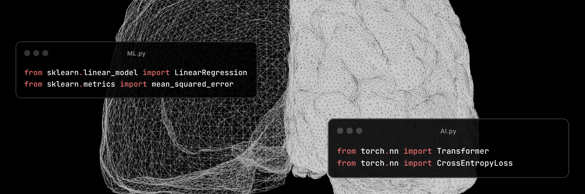

<div align="center">

# Akshay Kumar Gautam



Applied AI • Edge Systems • ML Infrastructure

<a href="https://akgautam.com">Portfolio</a> •
<a href="https://x.com/Gautam_A_k">X / Twitter</a> •
<a href="https://www.linkedin.com/in/akshay-kumar-gautam-880b361a5">LinkedIn</a>

</div>

---

## About

I build practical AI systems that run beyond demos.

My work focuses on:
- local and edge AI
- multimodal systems
- robotics + AI integration
- inference optimization
- AI tooling and infrastructure

Most of my projects explore how modern models can become smaller, faster, and deployable on constrained hardware without sacrificing capability.

I care about systems that are efficient, observable, and useful in real environments.

---

## Selected Projects

### [OmnimatteZeroEfficient](https://github.com/Ak-Gautam/OmnimatteZeroEfficient)

Efficient adaptation and optimization work around Omnimatte-style video matting pipelines with a focus on practical deployment and computational efficiency.

### [Regularised_L_M](https://github.com/Ak-Gautam/Regularised_L_M)

Research-oriented work exploring regularisation techniques and Feature engineering for regression style predictive modeling for complex data.

---

## Interests

<div align="center">


</div>

---

## Stack

```txt
Python • PyTorch • CUDA • TensorFlow
ROS • OpenCV • Docker • Linux
Raspberry Pi • Arduino • C/C++
Flask • Git • Jupyter
